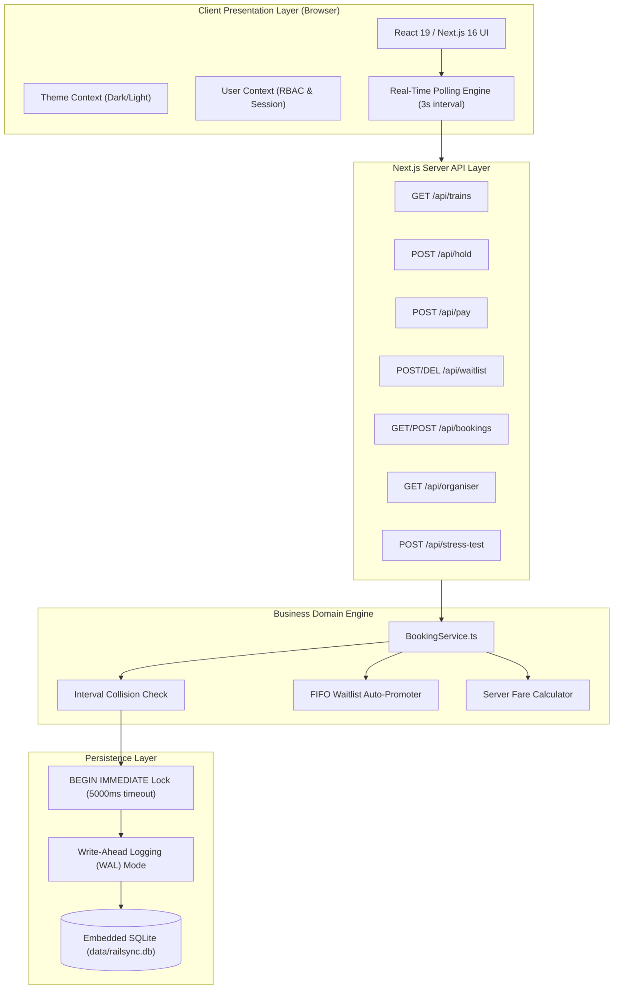
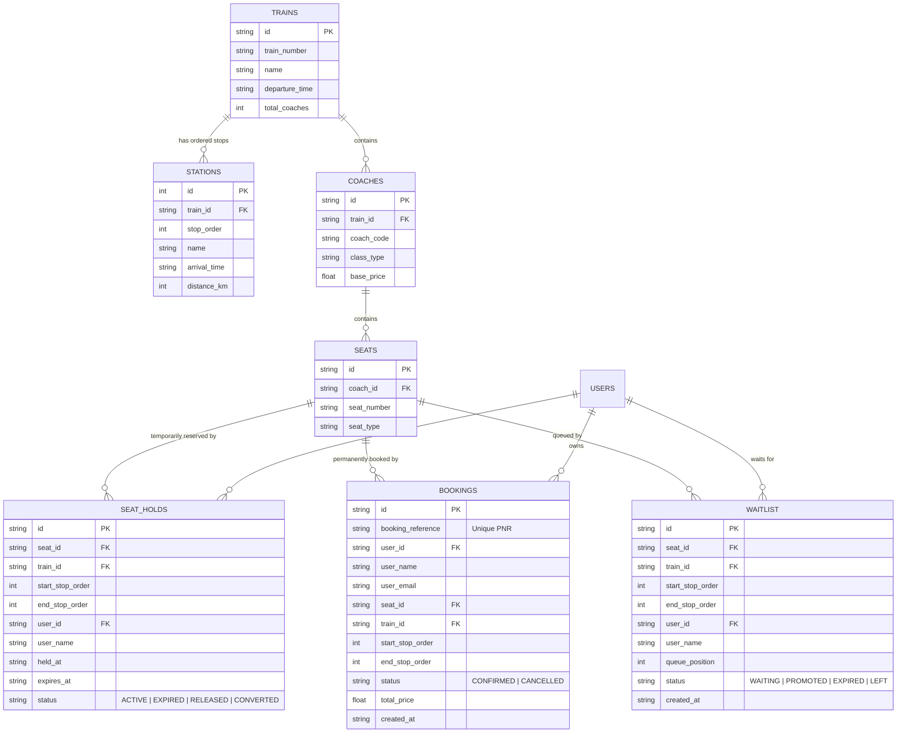
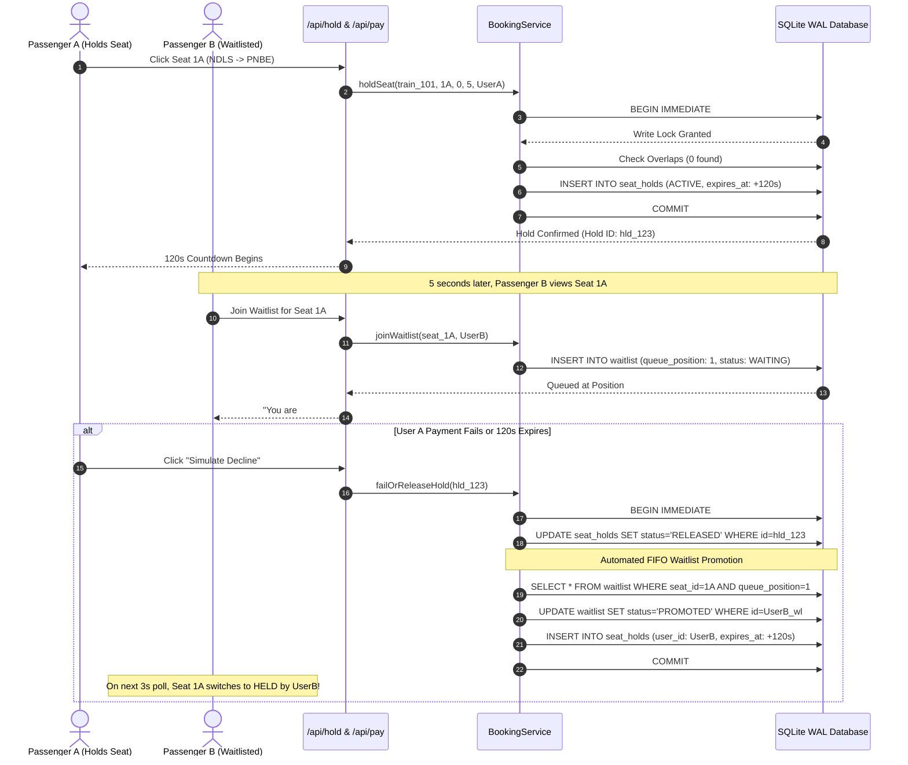
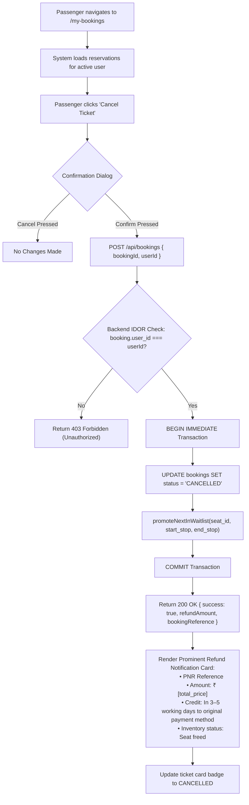

# Product Requirements Document (PRD)

# Project: RailSync Express
### High-Concurrency Multi-Stop Railway Reservation Engine
**Document Version:** 1.0.0  
**Status:** Approved & Implemented  
**Domain:** Public Transportation / Ticketing & Inventory Management  
**Author:** Engineering Team  

---

## 1. Executive Summary & Problem Definition

### 1.1 Problem Statement
Traditional ticketing systems for single-event venues (movies, concerts, airlines) treat inventory as a 1-to-1 binary state: a seat is either free or occupied. In multi-stop railway systems, a seat cannot be modeled as a single boolean. A train traverses a sequential corridor of $N$ stations (creating $N-1$ contiguous segments). A seat can be sold multiple times on the same train journey as long as the travel segments do not overlap in space and time.

Furthermore, popular rail routes suffer from severe **flash-sale concurrency spikes**, where dozens of users attempt to reserve the same seat simultaneously. Without robust concurrency controls, race conditions lead to catastrophic **double-bookings**.

### 1.2 The Solution
**RailSync Express** solves both challenges:
1. **Mathematical Segment Locking Engine:** Models seat availability across station stop orders using interval overlap theorems, maximizing coach capacity utilization.
2. **Zero Double-Booking ACID Architecture:** Enforces write serialization using database write locks (`BEGIN IMMEDIATE` in SQLite WAL mode), guaranteeing that under high-concurrency attacks, exactly one user secures the lock.
3. **Automated 120-Second Atomic Hold & FIFO Handover:** Grants an exclusive 120-second TTL window for payment. If payment is declined or expires, the seat automatically promotes the next person waiting in the waitlist.
4. **Transparent Cancellation & Refund Pipeline:** Restores inventory immediately and initiates an automated refund notice (3–5 working days).

---

## 2. User Personas & Permissions

| Persona | Role | Auth State | Capabilities & Access |
|---|---|---|---|
| **Guest Visitor** | Public | Unauthenticated | Browse 6 stations, inspect train schedules, view live coach seat maps, select seats, initiate holds. Cannot complete payment or join waitlists without logging in. |
| **Commuter / Passenger** | `passenger` | Authenticated | Browse routes, hold seats, execute simulated payments, receive PNR boarding pass, view trip history under "My Bookings", cancel tickets with 3–5 day refund pipeline, join FIFO seat waitlists. |
| **Train Operator / Admin** | `organiser` | Authenticated (`admin@railsync.com`) | All passenger capabilities plus exclusive access to the **Organiser Hub** (`/organiser`): live settled revenue, seat occupancy %, active checkout holds, waitlist count, and full audit tables. |

---

## 3. System Architecture & Component Design



---

## 4. Entity-Relationship Data Model



---

## 5. Detailed User Journeys & Process Flowcharts

### 5.1 End-to-End Booking & Checkout Flowchart

```mermaid
flowchart TD
    Start(["Passenger Visits Homepage"]) --> SelectRoute["Select Origin & Destination Stations"]
    SelectRoute --> FetchInventory["Fetch Train & Coach Inventory (/api/trains)"]
    FetchInventory --> RenderMap["Render Interactive Seat Grid"]
    RenderMap --> ClickSeat{"User Clicks a Seat"}
    
    ClickSeat -->|Status: BOOKED| ShowBooked["No Action (Seat Sold)"]
    ClickSeat -->|Status: HELD (By Other)| CheckAuthWL{"Is User Authenticated?"}
    
    CheckAuthWL -->|No| OpenLoginPrompt["Open Sign In Required Modal"]
    CheckAuthWL -->|Yes| OpenWaitlistModal["Show Waitlist Modal (Join Queue)"]
    OpenWaitlistModal --> JoinWL["User Joins Waitlist (#N in Queue)"]
    
    ClickSeat -->|Status: AVAILABLE| RequestHold["POST /api/hold (Acquire 120s TTL)"]
    RequestHold --> CheckCollision{"Interval Overlap Check"}
    
    CheckCollision -->|Conflict Detected| ConflictResp["Return 409 Conflict (Offer Waitlist)"]
    CheckCollision -->|Clean| GrantHold["Hold Granted: ActiveHold State Initialized"]
    
    GrantHold --> DrawerOpen["Open Floating Checkout Drawer (120s Countdown)"]
    DrawerOpen --> ActionChoice{"User Action at Drawer"}
    
    ActionChoice -->|Timer Hits 0:00| AutoExpire["Hold Expired: Auto-Promote Waitlist"]
    ActionChoice -->|Clicks 'Simulate Decline'| DeclinePay["Hold Released: Auto-Promote Waitlist"]
    ActionChoice -->|Clicks 'Confirm & Pay'| AuthCheck{"Is User Logged In?"}
    
    AuthCheck -->|Guest Passenger| LoginPrompt["Display 'Sign In to Book' Modal"]
    LoginPrompt --> RedirectLogin["Redirect to /login with Return URL"]
    
    AuthCheck -->|Authenticated| ExecutePay["POST /api/pay (Action: CONFIRM)"]
    ExecutePay --> CommitBooking["Generate PNR & Record Booking in DB"]
    CommitBooking --> ShowBoardingPass["Display Boarding Pass Modal with Confetti & QR"]
    ShowBoardingPass --> EndSuccess(["Booking Complete"])
```

---

### 5.2 120-Second Atomic Hold & FIFO Waitlist Auto-Promotion Sequence



---

### 5.3 Concurrency Race Condition Attack Resolution Sequence

```mermaid
sequenceDiagram
    autonumber
    actor Bot1 as Bot 01 (0ms Latency)
    actor Bot2 as Bot 02 (0ms Latency)
    actor Bot50 as Bot 50 (0ms Latency)
    participant API as /api/stress-test
    participant Engine as BookingService
    participant DB as SQLite WAL

    Note over Bot1, Bot50: 50 Bot Requests Arrive at the exact same millisecond
    par Simultaneous Execution
        Bot1->>API: POST /api/hold (Seat 1A)
        Bot2->>API: POST /api/hold (Seat 1A)
        Bot50->>API: POST /api/hold (Seat 1A)
    end

    API->>Engine: holdSeat() [Thread 1]
    Engine->>DB: BEGIN IMMEDIATE
    DB-->>Engine: Lock Acquired by Thread 1
    
    API->>Engine: holdSeat() [Thread 2]
    Engine->>DB: BEGIN IMMEDIATE (Queued in busy_timeout)

    API->>Engine: holdSeat() [Thread 50]
    Engine->>DB: BEGIN IMMEDIATE (Queued in busy_timeout)

    Engine->>DB: Check Overlaps -> 0 conflicts
    Engine->>DB: INSERT hold for Bot 01
    Engine->>DB: COMMIT
    DB-->>Bot1: HTTP 200 OK (Lock Granted)

    Note over DB: Lock released; Thread 2 enters
    Engine->>DB: Check Overlaps -> Bot 01's hold found!
    Engine->>DB: ROLLBACK
    DB-->>Bot2: HTTP 409 Conflict (Seat already held)

    Note over DB: Remaining 48 bots evaluate sequentially
    DB-->>Bot50: HTTP 409 Conflict (Seat already held)
    
    Note over Bot1, Bot50: Final Audit: 1 Lock Granted, 49 Rejected, 0 Double Bookings
```

---

### 5.4 Ticket Cancellation & Refund Workflow



---

## 6. Functional Requirements Specifications

### FR-1: Corridor & Segment Selection
* The system shall define a rail corridor with 6 ordered stations:
  1. `[0]` New Delhi (NDLS)
  2. `[1]` Kanpur Central (CNB)
  3. `[2]` Prayagraj Jn (PRYJ)
  4. `[3]` Varanasi Cantt (BSB)
  5. `[4]` Pt. Deen Dayal Upadhyaya (DDU)
  6. `[5]` Patna Jn (PNBE)
* The user shall select an origin stop $S_{start}$ and destination stop $S_{end}$ such that $S_{start} < S_{end}$.
* Total journey segments are computed as $\Delta S = S_{end} - S_{start}$.

### FR-2: Fare Calculation
* The fare shall be calculated entirely on the server using:
  $$\text{Fare} = \text{base\_price} \times (S_{end} - S_{start})$$
  * Coach E1 (Executive Chair Car): ₹650 per segment
  * Coach C1 (Chair Car): ₹380 per segment

### FR-3: Segment Interval Collision Logic
* Seat status is calculated per queried segment $[S_{start}, S_{end}]$.
* A seat is marked `BOOKED` if there exists any confirmed booking where:
  $$\text{booking.start\_stop\_order} < S_{end} \quad \land \quad \text{booking.end\_stop\_order} > S_{start}$$
* A seat is marked `HELD` if there exists an active unexpired hold satisfying the same interval condition.
* Otherwise, the seat is marked `AVAILABLE`.

### FR-4: 120-Second Atomic Hold
* When an available seat is selected, the server records an atomic hold with `expires_at = NOW() + 120 seconds`.
* A floating checkout drawer opens on the UI displaying an animated countdown bar.
* If 120 seconds elapse without payment confirmation, the hold expires and the seat returns to available inventory.

### FR-5: Guest Authentication Gate
* Guests may freely inspect seat grids and select seats.
* When clicking "Confirm & Pay" or attempting to join a waitlist, unauthenticated users (`id === 'usr_guest'`) are intercepted with a dedicated login modal.
* The modal directs users to `/login?redirect=/` to preserve their booking context.

### FR-6: Mock Payment Gateway
* Provides two testing actions:
  * **Confirm & Pay:** Validates payment, writes confirmed booking record, generates unique PNR (`PNR-XXXXXXX`), and presents boarding pass with celebratory confetti.
  * **Simulate Decline:** Terminates hold (`RELEASED`) and triggers waitlist promotion.

### FR-7: Automated FIFO Waitlist
* Passengers encountering a held seat can join the waitlist.
* Waitlist queue positions are ordered strictly by creation timestamp (`ASC`).
* When a seat hold is released or expired, the backend assigns the seat to the user with `queue_position = 1`.

### FR-8: Cancellation & Refund Pipeline
* Authenticated passengers can cancel their bookings via `/my-bookings`.
* The cancellation returns the fare amount and displays a dedicated refund banner:
  > *"Your money will be refunded to your original payment method in 3–5 working days."*
* The seat is immediately made available for booking or waitlist promotion.

### FR-9: Organiser Command Center
* Accessible only by users authenticated with the `organiser` role (`admin@railsync.com` / `admin123`).
* Hidden from normal passenger navigation.
* Displays dynamic SQL metrics: settled revenue (₹), occupancy percentage, active holds, waitlist count, and passenger audit logs.

### FR-10: Concurrency Test Bench
* Built-in interactive arena (`/concurrency-test`) executing 50 concurrent requests against a single seat to empirically prove Criterion 5 compliance.

---

## 7. Non-Functional Requirements (NFRs)

| NFR Category | Requirement Specification |
|---|---|
| **ACID Concurrency** | Zero double-bookings under concurrent load. Write locks enforced via `BEGIN IMMEDIATE` with `busy_timeout = 5000ms`. |
| **Response Time** | API endpoints (`/api/hold`, `/api/pay`) resolve in under 50ms under standard load. |
| **Data Integrity** | Foreign key constraints enforce referential integrity across trains, coaches, seats, holds, and bookings. |
| **IDOR Protection** | Ticket cancellations must verify `booking.user_id === session.userId`. |
| **Portability** | Embedded zero-configuration SQLite WAL database (`node:sqlite`). Runs on any machine without Docker or external DBMS setup. |
| **Accessibility & UX** | Fully responsive layout across mobile and desktop; includes native Dark/Light mode toggle. |

---

## 8. Edge Cases & Exception Handling Matrix

| Edge Case Scenario | Expected System Behavior | HTTP Code |
|---|---|:---:|
| Two passengers click Seat 1A at the exact same millisecond | Transaction write lock serializes requests. First user receives hold; second receives collision error and waitlist prompt. | 200 / 409 |
| Passenger holds seat but closes browser | Background query marks hold `EXPIRED` once `expires_at < NOW()`. Seat frees on next poll. | 200 |
| Payment declined | Hold status updated to `RELEASED`. Waitlist queue position 1 promoted immediately. | 200 |
| Non-overlapping segment booking | User A books Delhi ➔ Kanpur; User B books Kanpur ➔ Patna on same seat. Both succeed without conflict. | 200 / 200 |
| Passenger attempts to cancel another user's PNR | Server verifies user ID ownership; rejects unauthorized request. | 403 Forbidden |
| Normal user attempts to navigate to `/organiser` | Client hides tab; server and client block access with clearance required screen. | 403 Forbidden |
| Guest tries to complete checkout | Intercepted with Sign In Required modal; booking held until login or timeout. | UI Guard |
